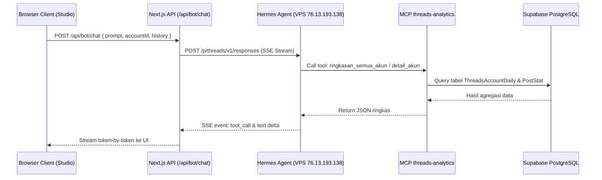

# Spesifikasi Desain: Web Dashboard Bot Telegram & Analisis Threads (BotDash)

- **Tanggal**: 2026-10-10
- **Topik**: Threads Telegram Bot Analytics & Hermes Prompt Studio
- **Lokasi Proyek**: `d:\PROJECT-WEB-SS\Bot_Dashboard`
- **Stitch Project**: `projects/6886495031210748254` ("Threads Telegram Bot Analytics Dashboard")
- **Design System Stitch**: `assets/4dab7884fd01460884b47343c81001dc` ("Precision Metric Workspace")

---

## 1. Ringkasan & Tujuan Proyek

Aplikasi **BotDash** adalah web dashboard modern berkinerja tinggi (*high-density SaaS*) untuk memantau performa akun Threads, mengelola bot Telegram analisis (`@threadss_analytics_bot`), dan menyediakan antarmuka **AI Prompt Studio** interaktif yang terhubung langsung dengan bot AI **Hermes** (profile `threads`) di VPS (`76.13.193.138`).

### Data & Layanan Terhubung:
1. **Database PostgreSQL (Supabase)**:
   - Berbagi database dengan sistem `D:\PROJECT-WEB-SS\auto-suka-shawarma`.
   - Berisi tabel metrik performa Threads: `ThreadsAccount`, `ThreadsAccountDaily`, `ThreadsPostStat`, serta tabel otomasi `AutoCommentTarget`, `AutoCommentKeyword`, dan `AutoCommentConfig`.
2. **Hermes AI Agent di VPS (`76.13.193.138`)**:
   - Berjalan pada user `suka-hermes`, profile `threads` dengan model `ANALYTIC-SOSMED-COMBO` via 9router.
   - Terhubung dengan server MCP `threads-analytics` untuk mengeksekusi alat kalkulasi performa secara otomatis.

---

## 2. Standar Desain & Aturan UI/UX Mutlak

Sesuai aturan mutlak pengembangan:
1. **Warna Primer Solid Blue (Dilarang Gradien)**:
   - Warna Primer: Solid Royal Blue (`#2563EB`, hover: `#1D4ED8`, active: `#1E40AF`).
   - Warna Netral: Solid Slate Canvas (`#F8FAFC`), Cards (`#FFFFFF`), Sidebar Navigasi (`#0F172A`), Border Subtil (`#E2E8F0` & `#CBD5E1`).
   - Dilarang keras menggunakan efek warna gradien pada background, border, teks, maupun tombol.
2. **Dilarang Menggunakan Emoji**:
   - Seluruh indikator dan ikon navigasi wajib menggunakan ikon SVG modern garis (*monoline stroke*) dari library `lucide-react`.
3. **Komponen UI Wajib 100% Custom (Dilarang Native Controls)**:
   - Dilarang memakai tag `<select>` bawaan browser, alert standar OS, atau input search default.
   - Menggunakan komponen kustom: Custom Dropdown Select, Custom Segmented Tabs, Custom Toggle Switch, Custom Modal Dialog, Custom Debounced Search Box.
4. **Konfirmasi Penghapusan Data Destruktif**:
   - Setiap aksi `DELETE` data pada database wajib menampilkan modal persetujuan dengan judul tegas:
     `# KONFIRMASI PENGHAPUSAN DATA` beserta rincian item, tabel, dan dampak penghapusan.
5. **Optimasi Performa Super Kencang**:
   - Pemilihan kolom kueri spesifik (tanpa `SELECT *`), penggunaan indexing kolom (`[threadsAccountId, date]`, `[workspaceId, createdAt]`), pagination, dan pencegahan N+1 query.

---

## 3. Layar Desain di Google Stitch

Desain antarmuka telah dibuat lengkap dan teruji di Google Stitch MCP:

### Layar 1: Threads Analytics Hub (Main Dashboard)
- **Screen ID**: `5fadd4ef917349c880682aec8d18349c`
- **Thumbnail URL**: [Lihat Screenshot Layar 1](https://lh3.googleusercontent.com/aida/AEtjO1Xv9W6SMUpW4i2jkajVJU4G6pPwjua7G5DhLKC21b7SDkKYKiOOYvxlOicHOrhphZaZZxLMTDOBAjib0_rlI4FFvJYR1hhpFxwSnw7LVJkxypiyEE47OITB39PzOWkXYqSMlwBh2jm_tOP9_ExxpgMCMaAh2-5y_u31sWXcafPWn-4olpzbsZ2MRRl6R5oljS9bmaU3wPXhEMaFvk8oYl4ZPE9PgecaXPxoM82FlsT3cUJnJXMc6IWi34Y)
- **Komponen**:
  - Sidebar Navigasi Dark Slate (`#0F172A`) dengan indikator solid blue.
  - Top Bar dengan Account Switcher kustom, Status Latency Bot (12ms), dan tombol `Trigger Sync`.
  - 4 Kartu Metrik Utama: Total Views (184.2K), Engagement Rate (5.2%), Total Interaksi (9,580), Pertumbuhan Followers (+412).
  - Grafik Tren Views & Interaksi Harian (65% width) + Matriks Distribusi Jam Sibuk / Golden Hour WIB (35% width).
  - Tabel Performa Postingan: Tabs "Top Performer", "Flop / Evaluasi", dan "Semua Post" dengan tombol aksi cepat `Prompt Hermes` dan `Buka di Threads`.

### Layar 2: Hermes AI Prompt Studio
- **Screen ID**: `1e30d611d0df43db927cfd4f4aa06518`
- **Thumbnail URL**: [Lihat Screenshot Layar 2](https://lh3.googleusercontent.com/aida/AEtjO1V5Qb5Q-5j870wwbAEc-RQCfUnHg3Kbtbh9-EKKV_WGumUtNk1TpjrwmV3vZSTlgMlj5xCZQBB-Jv9h4h_PmSYDArwVwuFk-3w8SSqnbv6sRUU49UpSJC_w8o6rvlXcnlC7bOccfSJWoOzopkl_oZNz__KqkKcH9J65MzZVl6o32inz1MmISGEZRRLRzBdA9N817AvxVLI68pcCkBrPDEx6IX4J9QD9VslCyXyut53F5tv1hyeX7IwIR9M)
- **Komponen**:
  - Horizontal Chips Preset Prompt: `[Analisis Performa 7 Hari]`, `[Buat 3 Draft Postingan Besok]`, `[Evaluasi Postingan Flop]`, `[Rekomendasi Waktu Posting]`.
  - Stream Percakapan Real-Time dengan kartu eksekusi MCP tool (`ringkasan_semua_akun`, `detail_akun`), format teks output terstruktur, dan tombol aksi draf (*Salin Draf*, *Kirim ke Bot Telegram*, *Regenerate*).
  - Command Bar Bawah: Input multi-line dengan shortcut `Ctrl+Enter`, slider temperature, dan tombol kirim solid royal blue.
  - Drawer Konteks Kanan (30%): Info memori aktif (4/12 turns), daftar alat MCP terhubung, dan widget data live akun `@sukashawarma`.

### Layar 3: Bot Manager & Auto-Comment Operations
- **Screen ID**: `ba39d725fed6492089f93fa5b4ca5f15`
- **Thumbnail URL**: [Lihat Screenshot Layar 3](https://lh3.googleusercontent.com/aida/AEtjO1X1fDZX0LgtoLh3NpgL4u4q7O2SJO3phE47SW1UjWSCFfwxDimO6m-D-HxX3Q3MCWRJxLSDPwREKrVHyAdh7k2aI6RtHesYM9W4ol4PMsv7BEWi5rpi2LDPK2vO5rUvnDBHDYWM6BMynutaMg7QSDcQNxiXZtpdWgl2P2XkjTfHW-X_lgBZEwePgArzWsW2ZD16GYpvqIvB64FqKFVahb-y6rjQ6zaDhRdh3XAT-vcJ3-BYcesBefGECEA)
- **Komponen**:
  - Kartu Konfigurasi Bot Telegram: status polling, whitelist chat ID dengan kontrol tambah/hapus, jadwal laporan harian (06:00 WIB), tombol uji kirim.
  - Kartu Auto-Comment Guardrails: toggle master aktif, pengaturan cooldown penulis (30 hari), interval komentar (15 menit), batas usia postingan (24 jam), dan daftar blacklist akun.
  - Tabel Monitoring Target Auto-Komentar: status badge solid (*TERKIRIM*, *DILEWATI*, *GAGAL*), preview komentar AI, alasan filter.
  - Modal Konfirmasi Destruktif dengan teks besar `# KONFIRMASI PENGHAPUSAN DATA`.

---

## 4. Arsitektur Teknis & Tech Stack

- **Framework**: Next.js 16 (App Router) + React 19
- **Language**: TypeScript 5+ (Strict Mode)
- **Styling**: Tailwind CSS + Custom CSS Variables (Solid Royal Blue Palette)
- **Icons**: `lucide-react` (Strictly SVG)
- **Database Client**: `@prisma/client` & `pg` (Koneksi langsung ke PostgreSQL Supabase)
- **State Management**: Zustand / React Context untuk filter akun & riwayat chat
- **Streaming**: Server-Sent Events (SSE) via Web Streams API untuk respon prompt bot Hermes token-by-token

---

## 5. Struktur Direktori Proyek

```
Bot_Dashboard/
├── src/
│   ├── app/
│   │   ├── layout.tsx                     # Global layout, fonts, navigation wrapper
│   │   ├── page.tsx                       # Root route (redirect ke /analytics)
│   │   ├── analytics/
│   │   │   ├── page.tsx                   # Layar 1: Threads Analytics Hub
│   │   │   └── [accountId]/page.tsx       # Detail analitik per akun
│   │   ├── prompt-studio/
│   │   │   └── page.tsx                   # Layar 2: Hermes AI Prompt Studio
│   │   ├── bot-manager/
│   │   │   └── page.tsx                   # Layar 3: Bot Telegram & Auto-Comment
│   │   └── api/
│   │       ├── analytics/
│   │       │   ├── overview/route.ts      # Metrik ringkas & tren harian
│   │       │   └── posts/route.ts         # Tabel postingan (top/flop)
│   │       ├── bot/
│   │       │   ├── chat/route.ts          # SSE streaming prompt ke Hermes VPS
│   │       │   ├── status/route.ts        # Status polling bot Telegram
│   │       │   └── test-message/route.ts  # Trigger uji pesan Telegram
│   │       └── auto-comments/
│   │           ├── targets/route.ts       # Log komentar terkirim/dilewati
│   │           └── rules/route.ts         # Konfigurasi guardrail
│   ├── components/
│   │   ├── ui/                            # 100% CUSTOM UI COMPONENTS
│   │   │   ├── custom-select.tsx          # Dropdown kustom
│   │   │   ├── custom-tabs.tsx            # Tab switcher kustom
│   │   │   ├── custom-toggle.tsx          # Toggle switch kustom
│   │   │   ├── custom-modal.tsx           # Modal wrapper
│   │   │   ├── custom-search.tsx          # Input search kustom
│   │   │   ├── metric-card.tsx            # Kartu statistik ringkas
│   │   │   ├── data-table.tsx             # Tabel data kustom
│   │   │   └── delete-confirm-modal.tsx   # Modal konfirmasi teks besar
│   │   ├── layout/
│   │   │   ├── sidebar.tsx                # Sidebar navigasi slate
│   │   │   └── header.tsx                 # Header atas breadcrumbs & status
│   │   ├── analytics/                     # Visualisasi chart & time distribution
│   │   └── prompt-studio/                 # Chat viewport & context drawer
│   └── lib/
│       ├── db.ts                          # Prisma client instance
│       ├── hermes.ts                      # Client API Hermes VPS proxy
│       └── utils.ts                       # Format angka, WIB date, tabular helpers
├── prisma/
│   └── schema.prisma                      # Skema prisma untuk Threads & Bot
├── docs/
│   └── superpowers/specs/
│       └── 2026-10-10-threads-bot-dashboard-design.md
├── tailwind.config.ts
├── tsconfig.json
├── package.json
└── .env.example
```

---

## 6. Alur Prompting Hermes & Fallback



Bila koneksi ke Hermes di VPS mengalami kendala jaringan, endpoint `/api/bot/chat` secara otomatis mengaktifkan fallback internal ke AI provider bawaan (9router direct / Gemini) dengan injeksi konteks data langsung dari database lokal.

---

## 7. Rencana Penanganan Error & Keamanan

1. **Keamanan Kredensial**:
   - Token Telegram Bot, Kunci API Hermes, dan Database URL tersimpan eksklusif di sisi server (`.env.local`), tidak pernah bocor ke browser client.
2. **Koneksi Database Cepat & Hemat Resource**:
   - Menggunakan connection pooler (`pgbouncer=true` port 6543) dari Supabase untuk mencegah kehabisan batas koneksi.
3. **Penyaringan Konten & Validasi**:
   - Input prompting divalidasi dengan Zod schema sebelum diteruskan ke Hermes.
